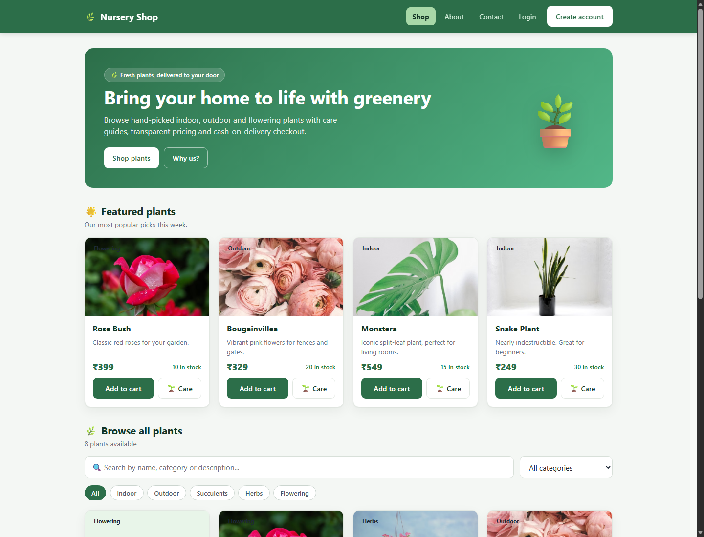
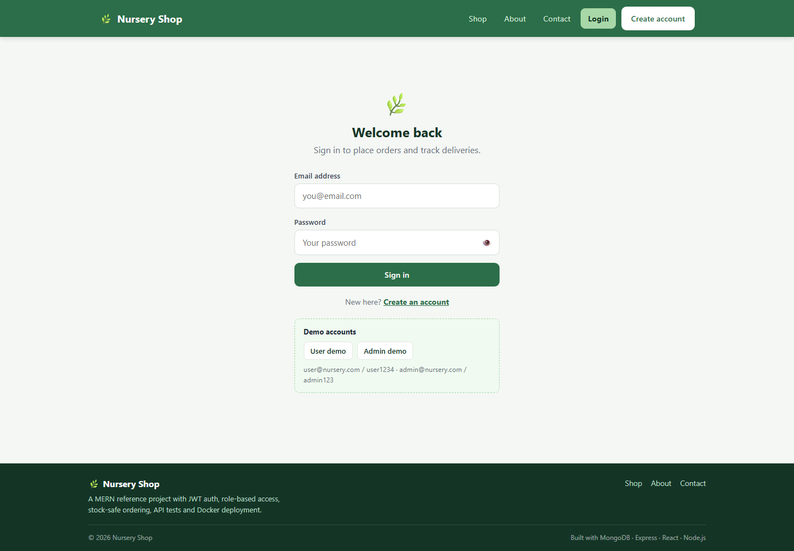

# 🌿 Nursery Shop

A production-minded **MERN** plant store built to demonstrate real-world full-stack engineering: secure JWT authentication, role-based access control, server-side order pricing, atomic stock management, API tests, Docker deployment and a responsive React frontend.

[](https://github.com/devrana2575/nursery-shop/actions/workflows/ci.yml)
[](LICENSE)
[](https://nodejs.org/)
[](https://react.dev/)
[](https://www.mongodb.com/)

---

## Overview

Nursery Shop is a complete e-commerce flow for a plant nursery:

- Customers browse a searchable, paginated catalogue, read plant care guides, keep a persistent cart and place cash-on-delivery orders.
- Admins manage inventory, move orders through a strict fulfilment workflow, review revenue/inventory stats and read contact messages.
- Every price and order total is calculated on the server. Stock is decremented atomically and rolled back if an order fails.

### Demo accounts

| Role  | Email               | Password   |
| ----- | ------------------- | ---------- |
| Admin | `admin@nursery.com` | `admin123` |
| User  | `user@nursery.com`  | `user1234` |

> These accounts are created by the seed script for local development only. Change or remove them before deploying to production.

---

## Screenshots

| Storefront | Sign in |
| ---------- | ------- |
|  |  |

---

## Features

### Customer experience

- Browse plants with server-side search, category filters and pagination.
- Featured plants, care guides and transparent stock indicators.
- Persistent cart stored in `localStorage`.
- JWT-based sign up / sign in with session restore.
- Place orders with a delivery address; totals are always recalculated server-side.
- Order history with status tracking and self-service cancellation while pending.
- Contact form persisted to MongoDB.
- Responsive layout, keyboard-friendly controls, loading/empty/error states and toast notifications.

### Admin experience

- Dashboard with plant count, low-stock count, order counts and delivered revenue.
- Create, edit and delete plants with image URLs and care tips.
- Order workflow: `Pending → Confirmed → Delivered`, with cancellation allowed before delivery.
- Cancelling an order restores stock exactly once.
- Contact inbox with unread state, mark-as-read and delete.

### Engineering

- Layered Express architecture: `routes → controllers → models` with shared middleware.
- `bcryptjs` password hashing and signed JWTs (`jsonwebtoken`).
- `express-validator` request validation and consistent JSON error responses.
- `helmet`, CORS allow-list, rate limiting, compression and request logging.
- Server-side order pricing and atomic `findOneAndUpdate` stock decrement with rollback.
- React Router v7 routes with protected and guest-only route guards.
- Axios API layer with a bearer-token interceptor and automatic session invalidation on `401`.
- Auth, Cart and Toast contexts; reusable form, modal, pagination and status components.
- 30 API tests using Node's built-in test runner + Supertest.
- GitHub Actions CI, Dockerfiles, Nginx SPA config and Docker Compose.
- Environment-based configuration with safe examples checked in.

---

## Tech stack

| Layer      | Technology |
| ---------- | ---------- |
| Frontend   | React 18, React Router 7, Vite 4, Axios |
| Backend    | Node.js, Express 4, Mongoose 8, JWT, bcryptjs, express-validator |
| Security   | Helmet, CORS allow-list, express-rate-limit, bcrypt, JWT expiry |
| Database   | MongoDB 7 |
| Testing    | Node.js `node:test`, Supertest |
| DevOps     | Docker, Docker Compose, Nginx, GitHub Actions |
| Tooling    | npm, dotenv, morgan, compression |

---

## Architecture

```
┌─────────────────────────────┐
│  React SPA (Vite)           │
│  Router · Contexts · Axios  │
└──────────────┬──────────────┘
               │  /api/*  (Bearer JWT)
               ▼
┌─────────────────────────────┐
│  Express API                │
│  routes → controllers       │
│  middleware: auth, validate │
│  models: User, Plant, Order │
└──────────────┬──────────────┘
               │ Mongoose
               ▼
┌─────────────────────────────┐
│  MongoDB                    │
└─────────────────────────────┘
```

### Repository layout

```
nursery-final/
├── backend/
│   ├── src/
│   │   ├── config/          # env + MongoDB connection
│   │   ├── controllers/     # auth, plants, orders, contact
│   │   ├── middleware/      # auth, validation, errors, rate limits
│   │   ├── models/          # User, Plant, Order, Message
│   │   ├── routes/          # REST route definitions
│   │   ├── utils/           # AppError, asyncHandler, JWT, query helpers
│   │   └── app.js
│   ├── tests/api.test.js
│   ├── seed.js
│   ├── server.js
│   └── Dockerfile
├── frontend/
│   ├── src/
│   │   ├── api/             # Axios client + endpoint modules
│   │   ├── components/      # shared UI components
│   │   ├── context/         # Auth, Cart, Toast providers
│   │   ├── pages/           # route-level screens
│   │   ├── utils/           # validation + formatting
│   │   └── App.jsx
│   ├── nginx.conf
│   └── Dockerfile
├── .github/workflows/ci.yml
├── docker-compose.yml
└── README.md
```

---

## Getting started

### Prerequisites

- Node.js 18 or newer (`.nvmrc` pins Node 20)
- npm 9+
- MongoDB 6/7 running locally, or a MongoDB Atlas connection string

### 1. Clone and install

```bash
git clone https://github.com/devrana2575/nursery-shop.git
cd nursery-shop
npm run install:all
```

### 2. Configure the backend

```bash
cd backend
cp .env.example .env
```

Edit `backend/.env` and set at least `MONGODB_URI` and `JWT_SECRET`. Generate a secret with:

```bash
node -e "console.log(require('crypto').randomBytes(48).toString('hex'))"
```

### 3. Seed demo data

```bash
npm run seed
```

This creates the admin and demo user (passwords are hashed by the User model) and inserts 8 plants.

### 4. Run the app

From the repository root, in two terminals:

```bash
npm run dev:backend
npm run dev:frontend
```

Or from each folder:

```bash
cd backend && npm run dev
cd frontend && npm run dev
```

- Frontend: <http://localhost:5173>
- API: <http://localhost:5000/api>
- Health check: <http://localhost:5000/api/health>

Vite proxies `/api` to `http://localhost:5000` during development, so no CORS configuration is needed locally.

---

## Environment variables

### Backend (`backend/.env`)

| Variable | Required | Default | Description |
| -------- | -------- | ------- | ----------- |
| `NODE_ENV` | No | `development` | `development`, `test` or `production` |
| `PORT` | No | `5000` | API port |
| `MONGODB_URI` | Yes | `mongodb://127.0.0.1:27017/nursery` | MongoDB connection string |
| `JWT_SECRET` | Yes in production | dev fallback | Long random string used to sign tokens |
| `JWT_EXPIRES_IN` | No | `7d` | Token lifetime |
| `CORS_ORIGIN` | No | `http://localhost:5173` | Comma-separated allowed browser origins |
| `RATE_LIMIT_WINDOW_MS` | No | `900000` | General API rate-limit window |
| `RATE_LIMIT_MAX` | No | `300` | Requests per window per IP |
| `AUTH_RATE_LIMIT_MAX` | No | `20` | Auth/contact attempts per window per IP |

### Frontend (`frontend/.env`)

| Variable | Required | Default | Description |
| -------- | -------- | ------- | ----------- |
| `VITE_API_URL` | No | `/api` | API base URL. Leave as `/api` to use the Vite proxy or Nginx proxy |

---

## API reference

Base URL: `/api`

| Method | Endpoint | Access | Description |
| ------ | -------- | ------ | ----------- |
| `GET` | `/health` | Public | Service + database health |
| `POST` | `/auth/register` | Public (rate limited) | Create an account and return a JWT |
| `POST` | `/auth/login` | Public (rate limited) | Sign in and return a JWT |
| `GET` | `/auth/me` | Authenticated | Current user profile |
| `GET` | `/plants` | Public | List plants. Query: `search`, `category`, `featured`, `page`, `limit`, `sort` |
| `GET` | `/plants/featured` | Public | Featured plants (max 4) |
| `GET` | `/plants/categories` | Public | Allowed categories |
| `GET` | `/plants/:id` | Public | Single plant |
| `POST` | `/plants` | Admin | Create a plant |
| `PUT` | `/plants/:id` | Admin | Update a plant |
| `DELETE` | `/plants/:id` | Admin | Delete a plant |
| `POST` | `/orders` | Authenticated | Place an order (`items: [{ plantId, quantity }]`, `address`) |
| `GET` | `/orders/mine` | Authenticated | Current user's orders |
| `PATCH` | `/orders/:id/cancel` | Authenticated | Cancel a pending order and restore stock |
| `GET` | `/orders` | Admin | All orders (optional `status` filter) |
| `GET` | `/orders/stats` | Admin | Dashboard counts and delivered revenue |
| `PUT` | `/orders/:id/status` | Admin | Move an order through the workflow |
| `POST` | `/contact` | Public (rate limited) | Store a contact message |
| `GET` | `/contact` | Admin | List messages + unread count |
| `PATCH` | `/contact/:id/read` | Admin | Mark a message as read |
| `DELETE` | `/contact/:id` | Admin | Delete a message |

### Order lifecycle

```
Pending ──► Confirmed ──► Delivered
   │            │
   └────────────┴──────► Cancelled  (restores stock)
```

Invalid transitions are rejected by the API. `Delivered` and `Cancelled` are terminal states.

### Example request

```bash
# Sign in
curl -X POST http://localhost:5000/api/auth/login \
  -H "Content-Type: application/json" \
  -d '{"email":"user@nursery.com","password":"user1234"}'

# Place an order (replace TOKEN and PLANT_ID)
curl -X POST http://localhost:5000/api/orders \
  -H "Content-Type: application/json" \
  -H "Authorization: Bearer TOKEN" \
  -d '{"items":[{"plantId":"PLANT_ID","quantity":2}],"address":"12 Garden View Road, Anand, Gujarat 388001"}'
```

---

## Scripts

Run these from the repository root:

| Command | Description |
| ------- | ----------- |
| `npm run install:all` | Install backend + frontend dependencies |
| `npm run dev:backend` | Start the API with nodemon |
| `npm run dev:frontend` | Start the Vite dev server |
| `npm run seed` | Seed demo users and plants |
| `npm run test` | Run the backend API test suite |
| `npm run build` | Create a production frontend build |
| `npm run start` | Start the backend in production mode |

---

## Testing

The backend uses Node's built-in test runner and Supertest:

```bash
cd backend
npm test
```

Coverage includes:

- health endpoint and validation errors
- registration, duplicate email, login, wrong password and `/auth/me`
- role-based plant creation and invalid plant payloads
- search/pagination metadata and featured plants
- server-computed order totals and stock decrement
- insufficient stock rejection
- order listing, admin listing and invalid status transitions
- order cancellation with stock restoration
- dashboard statistics
- contact message creation and admin-only access
- JSON 404 fallback

Tests run against a separate database (`nursery_test`). The GitHub Actions workflow starts a MongoDB service container and runs both the API tests and the frontend production build on every push and pull request.

---

## Docker

Docker Compose runs MongoDB, the API and the Nginx-served frontend.

```bash
cp .env.example .env
# Edit .env and set a strong JWT_SECRET

docker compose up --build
```

Then seed the database once:

```bash
docker compose exec backend node seed.js
```

| Service | URL |
| ------- | --- |
| Frontend | <http://localhost:8080> |
| API | <http://localhost:5000/api> |
| MongoDB | `localhost:27017` |

Stop the stack with `docker compose down`. Add `-v` to remove the MongoDB volume as well.

### Docker notes

- The frontend container proxies `/api` to the `backend` service through Nginx.
- The backend container does not include `.env`; configuration comes from Compose.
- `JWT_SECRET` is required by Compose and has no insecure default.
- Set `CORS_ORIGIN` to the public frontend origin when deploying.

---

## Deployment

### Backend (Render, Railway, Fly.io, etc.)

1. Create a MongoDB Atlas cluster and copy the connection string.
2. Deploy the `backend` folder as a Node service.
3. Set `NODE_ENV=production`, `MONGODB_URI`, `JWT_SECRET` and `CORS_ORIGIN` (your frontend URL).
4. Build command: `npm ci`; start command: `npm start`.
5. Run `node seed.js` once from the service shell if you want demo data.

### Frontend (Vercel, Netlify, Cloudflare Pages)

1. Set the project root to `frontend`.
2. Build command: `npm run build`; output directory: `dist`.
3. Set `VITE_API_URL` to your deployed API URL, for example `https://nursery-api.onrender.com/api`.
4. Add a SPA rewrite so all routes serve `index.html` (Vercel/Netlify do this automatically for Vite projects; otherwise add `/* → /index.html`).
5. Update the backend `CORS_ORIGIN` to include the deployed frontend origin.

---

## Security notes

- Passwords are hashed with bcrypt (cost factor 12) and never returned by the API.
- JWTs expire after `JWT_EXPIRES_IN` and are sent in the `Authorization` header.
- Admin-only routes are protected on the server, not just hidden in the UI.
- Request bodies are validated and size-limited.
- Helmet sets secure HTTP headers; rate limiting protects auth and contact endpoints.
- Order prices and totals are always recalculated from database values; client-supplied prices are ignored.
- Stock updates use conditional atomic operations and roll back on failure.
- Secrets live in environment variables; `.env` files are gitignored.

For production, also use HTTPS, a managed MongoDB instance, a strong unique `JWT_SECRET`, and a restrictive `CORS_ORIGIN`.

---

## Roadmap ideas

- Online payments (Razorpay/Stripe) and email receipts.
- Product image uploads to cloud storage instead of URLs.
- Refresh tokens and password reset flow.
- Admin analytics charts and CSV exports.
- End-to-end tests with Playwright.

---

## License

Released under the [MIT License](LICENSE).
